# 🍞 Juliane Vitória

**DevFluffyBread**

código, ideias e um cantinho para criar.

  

✦ &nbsp; 🥐 &nbsp; ✧ &nbsp; 🌷 &nbsp; ✦

 

Olá! Eu sou a Juliane. Seja bem-vindo ao meu cantinho no GitHub.  
Aqui você encontra meus projetos e experimentos com desenvolvimento.

 

[explorar projetos](https://github.com/DevFluffyBread?tab=repositories) &nbsp; · &nbsp; [portfólio](https://github.com/DevFluffyBread/portfolio)

 

### 🧺 na minha bancada

Tecnologias que fazem parte deste cantinho.

  
  
  
  
  
  
  
  

 

### 📚 direto da prateleira

| projeto | o que tem por aqui |
| :--- | :--- |
| 📖 **[Reading Tracker](https://github.com/DevFluffyBread/reading-tracker)** | Uma biblioteca pessoal para organizar livros, acompanhar leituras e avaliar histórias. |

 

### 🌱 um pouquinho a cada dia

  

 

✦ &nbsp; ✧ &nbsp; ✦

feito com carinho e um toque de pão quentinho. 🍞

